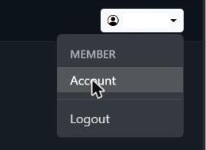
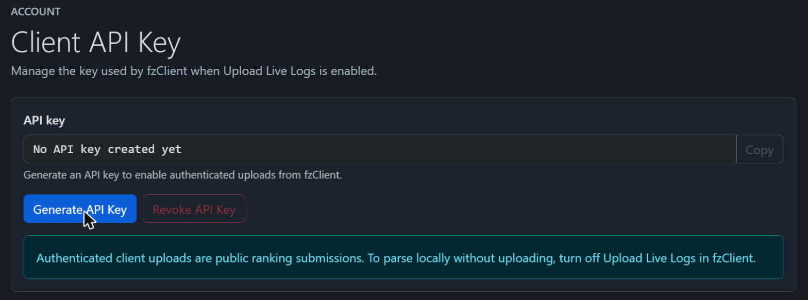
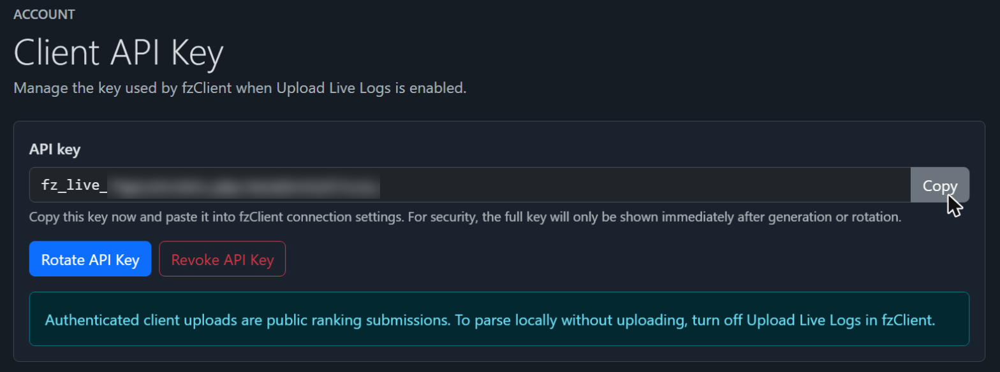

# Create an API Key

1. Open [https://fangbreaker.zone](https://fangbreaker.zone) or [https://frostreaver.zone](https://frostreaver.zone) and log in with Discord.

   

1. Open the menu under your name and choose **Account**.

   

1. Click **Generate API Key**. (If you already have a key you should reuse it. **Rotate API Key** makes a new key, and the old one stops working.)

   

1. Click **Copy**. The site shows the full key only this once, so if you lose it you'll need to revoke and generate a new one.

   

Note that one key works on both Fangbreaker and Frostreaver sites, so you can use either to create your API key.
